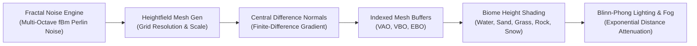

# Procedural Terrain Generator

[](https://en.wikipedia.org/wiki/C%2B%2B17)
[](https://www.opengl.org)
[](https://github.com/g-truc/glm)
[](LICENSE)

A real-time procedural 3D terrain generator and landscape visualizer built in modern C++17 and OpenGL 3.3 Core Profile. Synthesizes continuous fractal elevation meshes using multi-octave Fractal Brownian Motion (fBm) Perlin noise, analytical central-difference surface normals, dynamic altitude biomes, and 6-DOF free-flight camera controls.

---

## Architecture & Generation Pipeline



---

## Technical Features

- **Fractal Brownian Motion (fBm):** Superimposes multiple octaves of classic 2D Perlin noise with configurable lacunarity (frequency multiplier) and persistence (amplitude gain):
  $$H(x, z) = \sum_{i=0}^{n-1} \text{amplitude}_i \cdot \text{noise}(x \cdot \text{frequency}_i, z \cdot \text{frequency}_i)$$
- **Analytical Finite-Difference Normals:** Calculates accurate per-vertex surface normals using central-difference height gradients ($\mathbf{n} = \langle h_L - h_R, 2\epsilon, h_D - h_U \rangle$) rather than averaging polygon face normals.
- **Dynamic Altitude-Based Biomes:** Fragment shader smoothly blends across 5 geological elevation tiers:
  - Deep Water & Shorelines ($y < 0.2$)
  - Coastal Sand & Beaches ($0.2 \le y < 0.28$)
  - Lush Valley Grasslands ($0.28 \le y < 0.55$)
  - Rugged Mountain Rock ($0.55 \le y < 0.78$)
  - Alpine Snowcaps with sharp specular highlights ($y \ge 0.78$)
- **Interactive Parameter Tuning:** Runtime modification of noise frequency, fractal octaves, seed shifting, and wireframe mesh inspection.
- **6-DOF Free Flight Camera:** Smooth fly camera with pitch, yaw, WASD directional vectors, and speed boosting.

---

## Controls

| Key / Input | Action |
| :--- | :--- |
| **Mouse Drag (Left/Right)** | Pitch and Yaw camera rotation |
| **W / A / S / D** | Fly forward / left / backward / right |
| **Space / Left Ctrl** | Fly upward / downward |
| **Left Shift (Hold)** | Boost movement speed |
| **Up / Down Arrows** | Increase / decrease noise frequency (detail scale) |
| **+ / -** | Add / remove fractal noise octaves ($1 - 8$) |
| **R** | Re-seed Perlin permutation table with random seed |
| **M** | Toggle wireframe mesh overlay vs solid biomes |
| **Escape** | Cleanly exit application |

---

## Prerequisites

- **Compiler:** GCC 9+, Clang 10+, or MSVC 2019+ (C++17)
- **Build System:** CMake 3.20+
- **Mathematics:** GLM (`libglm-dev` or `glm`)
- **Windowing:** GLFW 3 (`libglfw3-dev`)
- **OpenGL:** Development headers (`libgl-dev`)

---

## Build & Run

```bash
cd ProceduralTerrainGenerator
cmake -B build -S . -DCMAKE_BUILD_TYPE=Release
cmake --build build -j$(nproc)
./build/ProceduralTerrainGenerator
```

---

## License

Distributed under the [MIT License](LICENSE).
